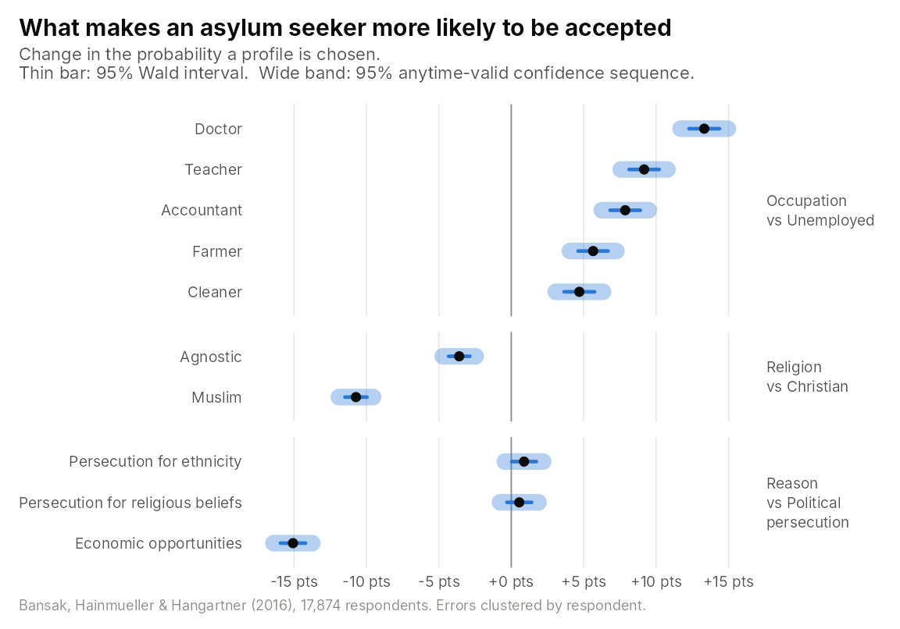
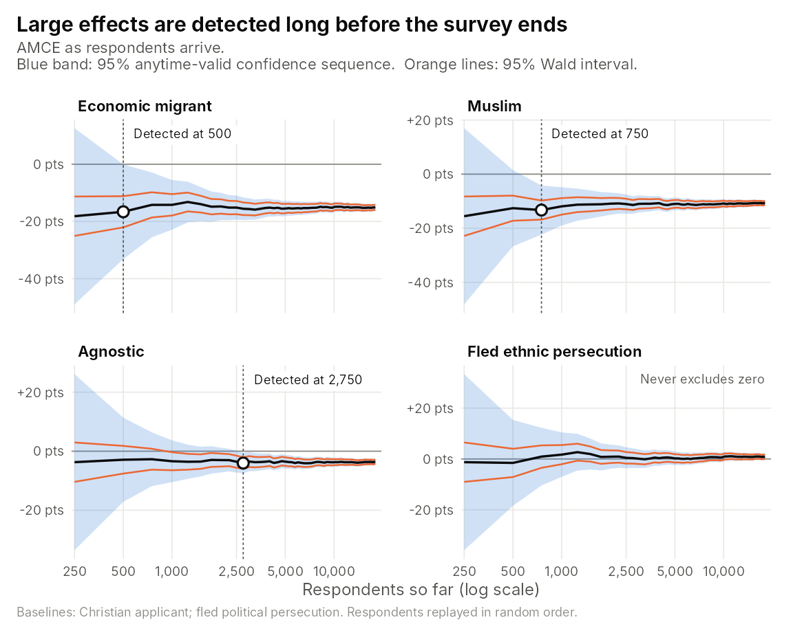

<!-- This article is precomputed because irw_fetch() needs a Redivis login.
     Edit conjoint.Rmd.orig, then run vignettes/articles/precompute.R. -->


Conjoint experiments show each respondent several randomly generated profiles and ask them
to choose between them. The quantities of interest are **average marginal component effects
(AMCEs)**, estimated as the coefficients of a linear probability model with standard errors
clustered by respondent.

Conjoint surveys are fielded over days or weeks, and it is natural to watch the estimates as
responses arrive. Classical confidence intervals and p-values are only valid at a single,
pre-planned sample size. `avlm` turns the same regression into **cluster-robust confidence
sequences and anytime-valid p-values** (Lindon, 2026; Molitor, Gosciak and Lindon, 2026). They
stay valid however often you look, so an effect can be declared as soon as the data show it.

## The data and the usual fit

Bansak, Hainmueller and Hangartner (2016) asked 18,000 Europeans to choose between pairs of
hypothetical asylum seekers, five pairs each. The data are in the
[Item Response Warehouse](https://itemresponsewarehouse.org/conjoint_standard.html), and this
is the standard analysis of three of the attributes:


```r
library(irw)
d <- irw_fetch("bansak_2016_asylum", source = "conj")
d$attr_occupation <- relevel(factor(d$attr_occupation), "Unemployed")
d$attr_religion   <- relevel(factor(d$attr_religion), "Christian")
d$attr_reason     <- relevel(factor(d$attr_reason), "Persecution for political views")

fit <- lm(choice ~ attr_occupation + attr_religion + attr_reason, data = d,
          weights = pmin(cov_survey_weight, 6))
```

## Making it anytime-valid

One line converts the fit. The respondent clusters are given the same way as in
`sandwich::vcovCL()`:


```r
library(avlm)
afit <- av(fit, g = 2191, cluster = ~id)
summary(afit)
#> 
#> Call:
#> lm(formula = choice ~ attr_occupation + attr_religion + attr_reason, 
#>     data = d, weights = pmin(cov_survey_weight, 6))
#> 
#> Residuals:
#>     Min      1Q  Median      3Q     Max 
#> -1.6078 -0.4170  0.0216  0.4123  1.8214 
#> 
#> Coefficients:
#>                                                  Estimate Std. Error t value p value
#> (Intercept)                                       0.51439    0.00492  104.62  < 2e-16
#> attr_occupationAccountant                         0.07864    0.00533   14.76  < 2e-16
#> attr_occupationCleaner                            0.04698    0.00539    8.71  6.9e-15
#> attr_occupationDoctor                             0.13320    0.00538   24.74  < 2e-16
#> attr_occupationFarmer                             0.05650    0.00528   10.71  < 2e-16
#> attr_occupationTeacher                            0.09171    0.00531   17.26  < 2e-16
#> attr_religionAgnostic                            -0.03595    0.00376   -9.57  < 2e-16
#> attr_religionMuslim                              -0.10723    0.00389  -27.55  < 2e-16
#> attr_reasonPersecution for ethnicity              0.00880    0.00436    2.02     0.49
#> attr_reasonPersecution for religious beliefs      0.00552    0.00437    1.26     1.00
#> attr_reasonSeeking better economic opportunities -0.15072    0.00443  -34.04  < 2e-16
#>  (1470 observations deleted due to missingness)
#> Multiple R-squared:  0.033,	Adjusted R-squared:  0.033
#> F-statistic:  353 on 10 and 17873 DF,  p-value: <2e-16 
#> Anytime-Valid: TRUE (g = 2191)
#> Robust Standard Error Type: CR1 
#> Clusters: 17874
```

`summary()` returns the familiar regression table. The standard errors are CR1
cluster-robust, and the p-values are anytime-valid. Muslim applicants are about 11 points less
likely to be chosen than Christian ones, and economic migrants about 15 points less likely than
people fleeing political persecution. Both effects are overwhelming even under anytime-valid
inference. `confint(afit)` gives the matching 95% confidence sequences.


## Confidence intervals and confidence sequences

A confidence sequence is a little wider than the classical interval computed on the same data.
That extra width is the price of being allowed to look at the data at any time:

<div class="figure">

</div>

## Detecting effects in flight

Now suppose the survey had been analysed while it was fielded, re-running the regression after
every 250 respondents. The data do not record the order in which people responded, so we replay
the respondents in a random order:


```r
set.seed(2016)
arrival <- sample(unique(d$id))
d$arrival <- match(d$id, arrival)
looks <- seq(250, length(arrival), by = 250)
terms <- c("attr_reasonSeeking better economic opportunities", "attr_religionMuslim",
           "attr_religionAgnostic", "attr_reasonPersecution for ethnicity")

path <- do.call(rbind, lapply(looks, function(n_resp) {
  fit_n <- lm(choice ~ attr_occupation + attr_religion + attr_reason,
              data = d[d$arrival <= n_resp, ], weights = pmin(cov_survey_weight, 6))
  cs <- confint(av(fit_n, g = 2191, cluster = ~id), parm = terms)
  data.frame(respondents = n_resp, term = terms, est = coef(fit_n)[terms],
             av_lo = cs[, 1], av_hi = cs[, 2])
}))
```


Because the confidence sequences hold **simultaneously at every look**, an effect can be
declared the first time its sequence excludes zero, with no penalty for having looked before.

<div class="figure">

</div>

The penalty for economic migrants is detected after 500
respondents, which is 2.8% of the
survey. The Muslim penalty is detected after 750 respondents
(4.2%), and the smaller Agnostic penalty after
2,750 (15.3%). Each of these is a valid
conclusion at the moment it is reached. A fixed-n analysis would have had to wait for all
18,021 respondents. The difference between ethnic and
political persecution is close to zero, and the confidence sequence never excludes zero, however
long you watch.

### References

Bansak, K., Hainmueller, J. and Hangartner, D. (2016). How economic, humanitarian, and
religious concerns shape European attitudes toward asylum seekers. *Science*, 354(6309),
217–222.

Lindon, M. (2026). Anytime-Valid Inference in Linear Models with Clustered Outcomes: Exact
Multivariate Tests and Cluster-Robust Confidence Sequences. arXiv:2610.25613.

Molitor, Gosciak and Lindon (2026). Anytime-Valid Inference in Conjoint Experiments.
[arXiv:2610.28979](https://arxiv.org/abs/2610.28979).
